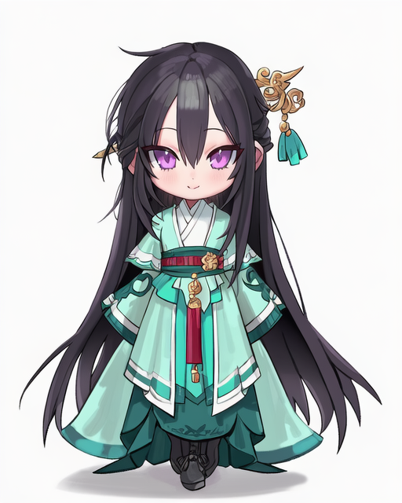
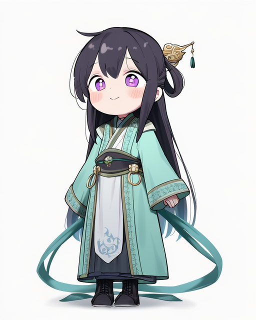
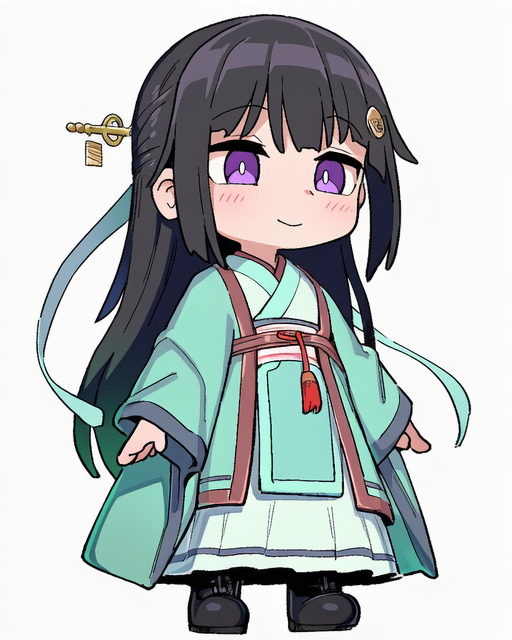
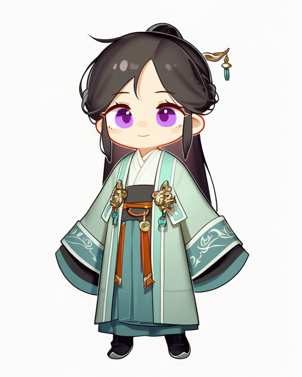
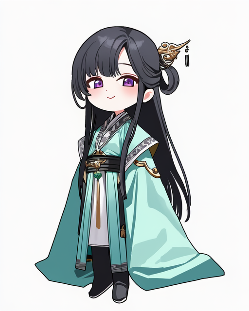
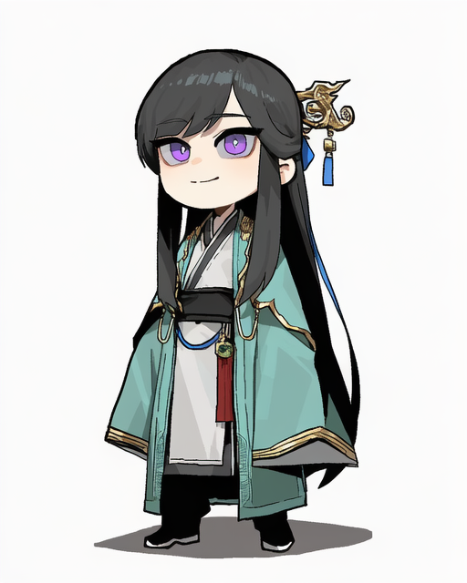
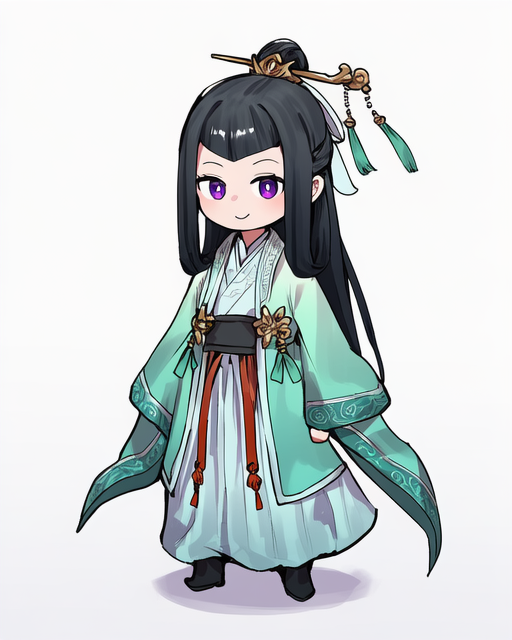
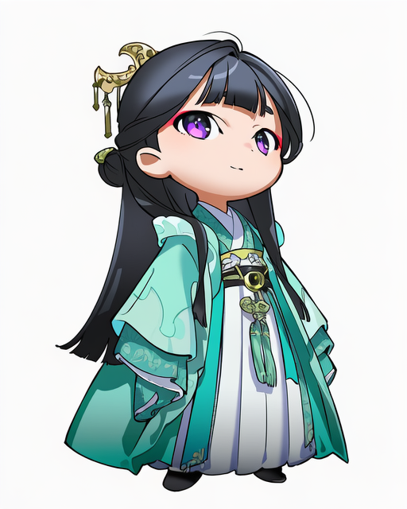
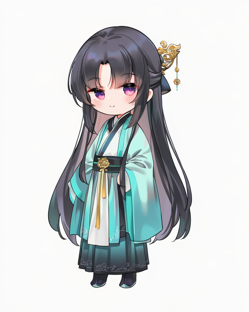
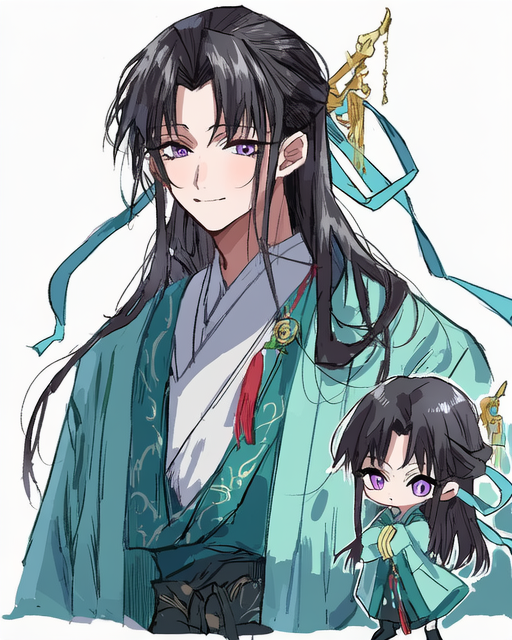

# Q版画师 001-010

[返回目录](../README.md)

## 001 · freng

画师标签：`artist:freng`

## 002 · healthyman

画师标签：`artist:healthyman`

## 003 · wagashi (dagashiya)

画师标签：`artist:wagashi (dagashiya)`

## 004 · tianliang_duohe_fangdongye

画师标签：`artist:tianliang_duohe_fangdongye`

## 005 · mx2j

画师标签：`artist:mx2j`

## 006 · gogalking

画师标签：`artist:gogalking`

## 007 · ie (raarami)

画师标签：`artist:ie (raarami)`

## 008 · yoneyama mai

画师标签：`artist:yoneyama mai`

## 009 · chen_bin

画师标签：`artist:chen_bin`

## 010 · na_tarapisu153

画师标签：`artist:na_tarapisu153`

构图偏差：出现额外人物或大小人物对照。

[下一组](011-020.md)
