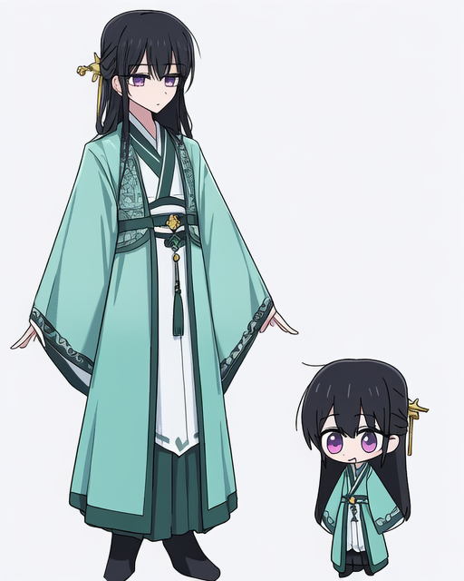
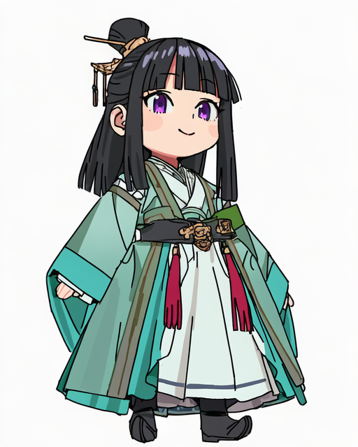
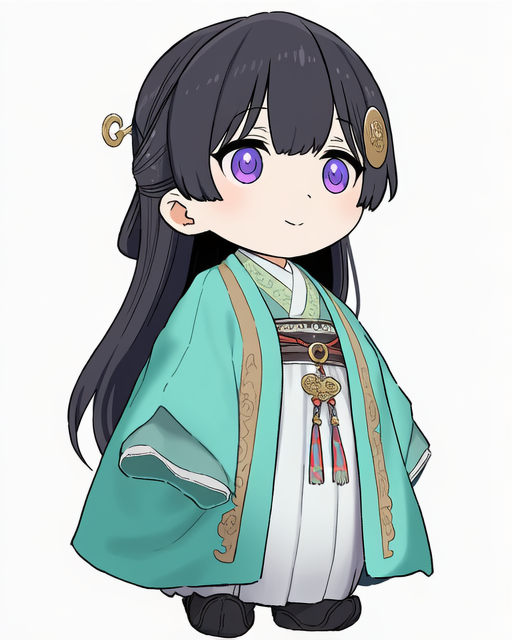
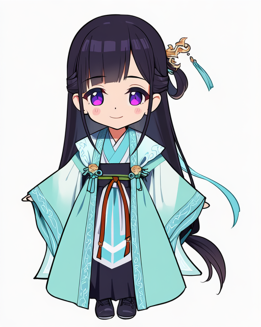
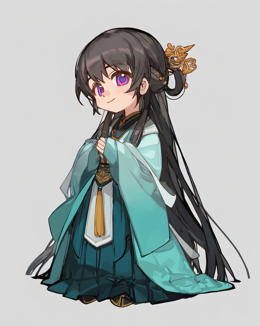
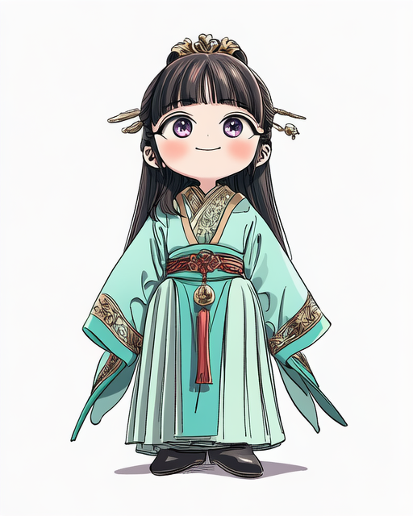
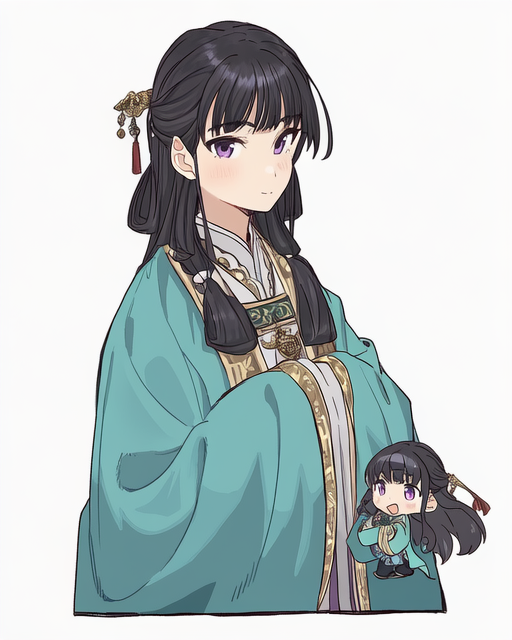
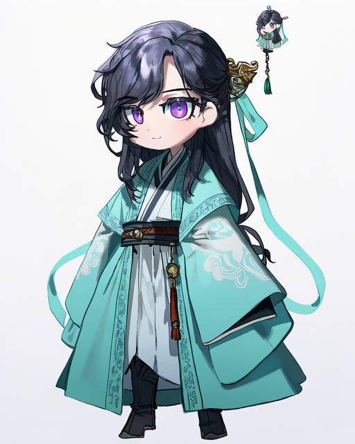
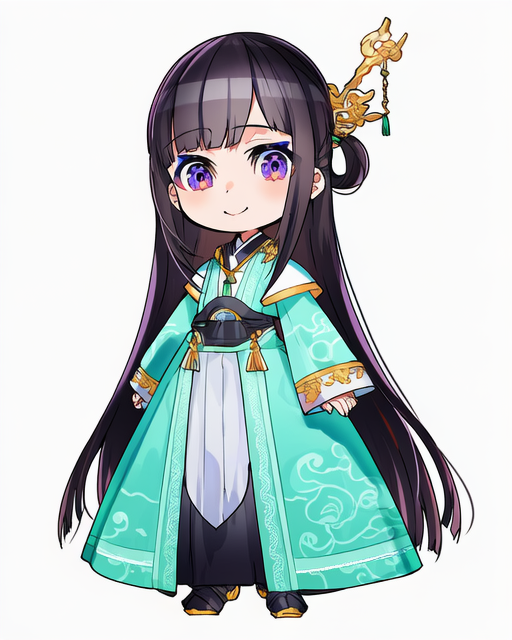
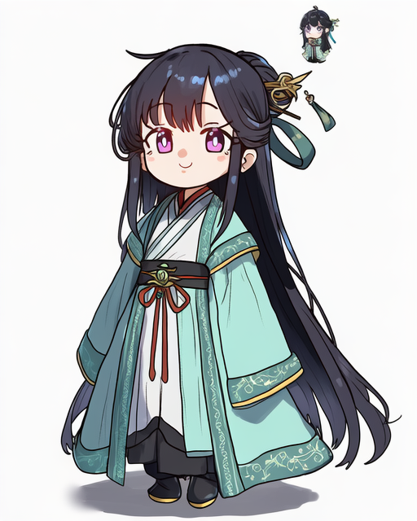

# Q版画师 011-020

[返回目录](../README.md)

## 011 · channel (caststation)

画师标签：`artist:channel (caststation)`

构图偏差：出现额外人物或大小人物对照。

## 012 · imamura ryou

画师标签：`artist:imamura ryou`

## 013 · shinjiro

画师标签：`artist:shinjiro`

## 014 · lunch (shin new)

画师标签：`artist:lunch (shin new)`

## 015 · ciloranko

画师标签：`artist:ciloranko`

## 016 · hiro (dismaless)

画师标签：`artist:hiro (dismaless)`

## 017 · teshima nari

画师标签：`artist:teshima nari`

构图偏差：出现额外人物或大小人物对照。

## 018 · quasarcake

画师标签：`artist:quasarcake`

## 019 · mika pikazo

画师标签：`artist:mika pikazo`

## 020 · ebora

画师标签：`artist:ebora`

[下一组](021-030.md)
