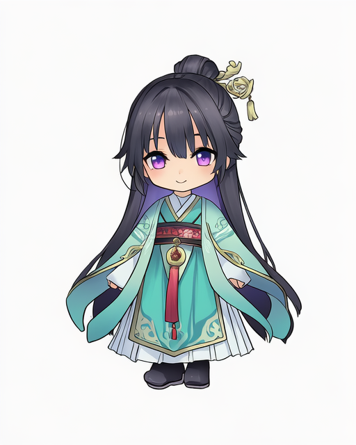
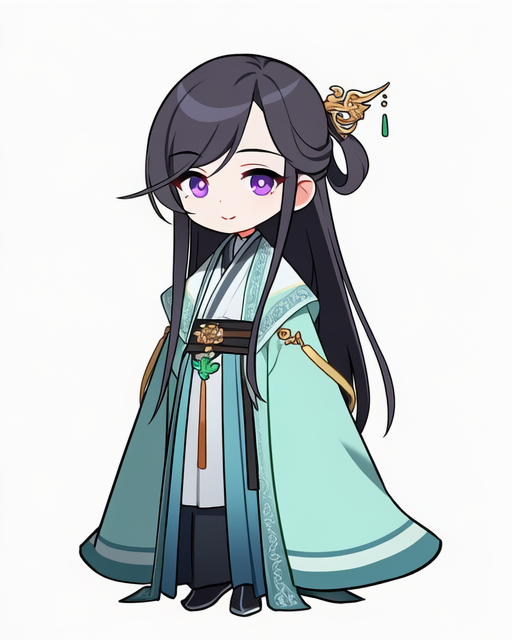
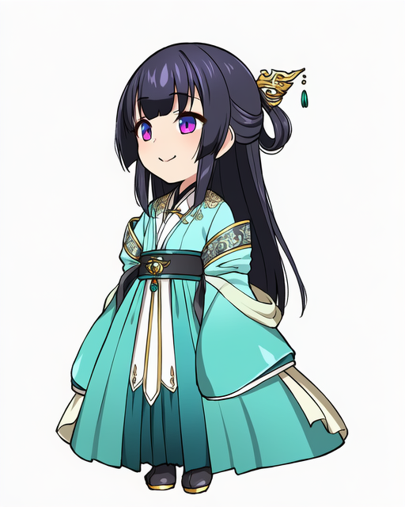
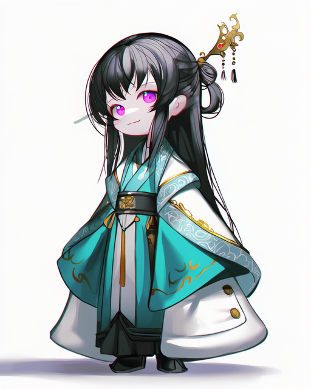
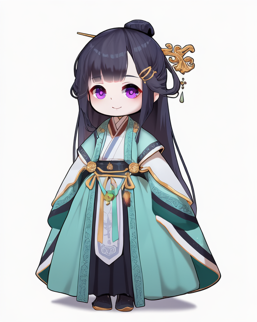
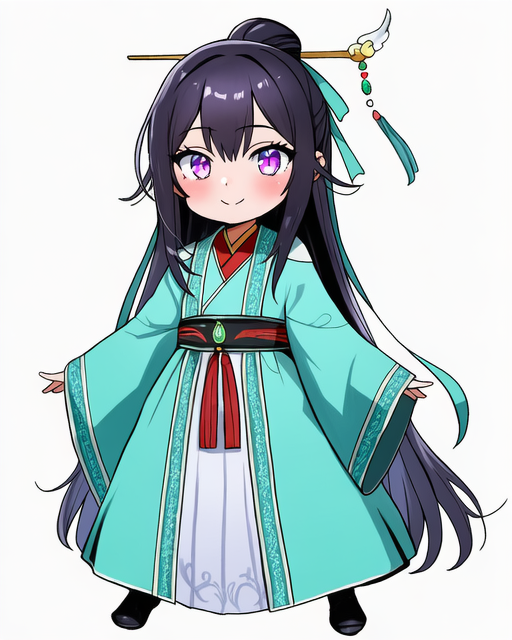
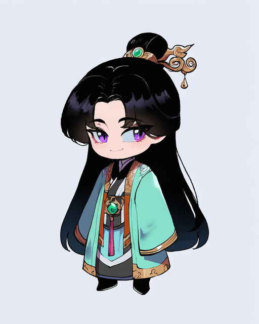
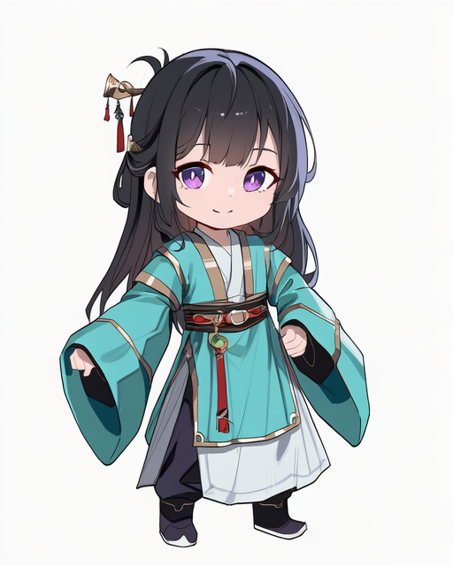
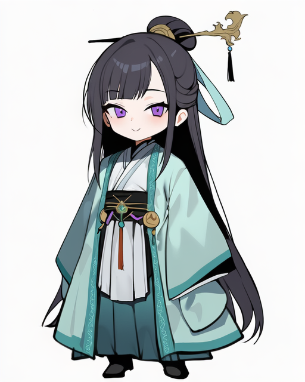
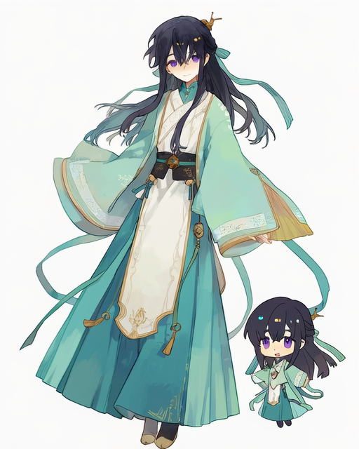

# Q版画师 101-110

[返回目录](../README.md)

## 101 · michiking

画师标签：`artist:michiking`

## 102 · yutokamizu

画师标签：`artist:yutokamizu`

## 103 · satou kuuki

画师标签：`artist:satou kuuki`

## 104 · iumu

画师标签：`artist:iumu`

## 105 · manzai_sugar

画师标签：`artist:manzai_sugar`

## 106 · momisan

画师标签：`artist:momisan`

## 107 · nyantcha

画师标签：`artist:nyantcha`

## 108 · re0n

画师标签：`artist:re0n`

## 109 · toma (toma50)

画师标签：`artist:toma (toma50)`

## 110 · bacheally

画师标签：`artist:bacheally`

构图偏差：出现额外人物或大小人物对照。

[下一组](111-120.md)
