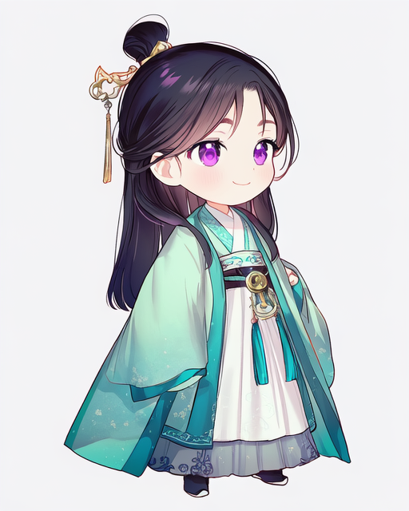
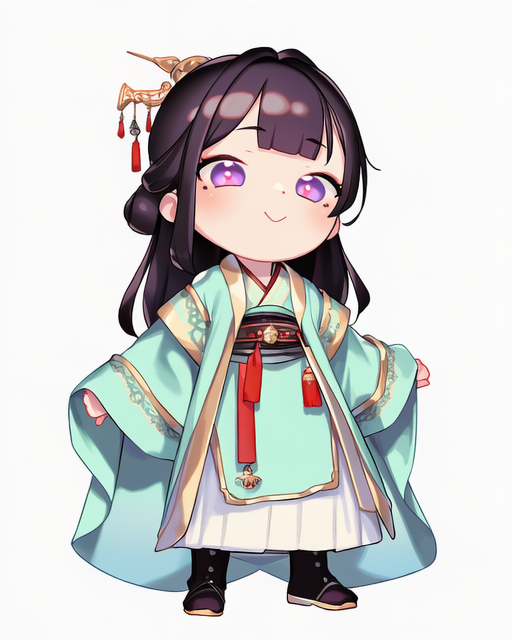
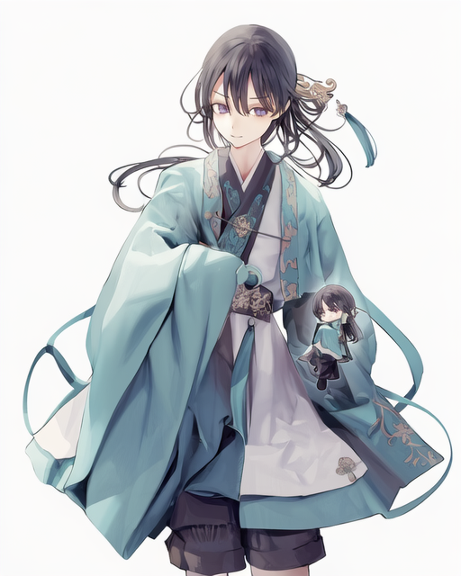
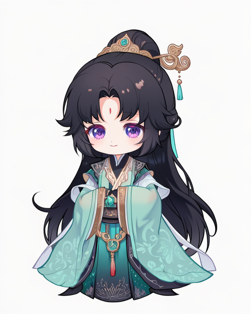
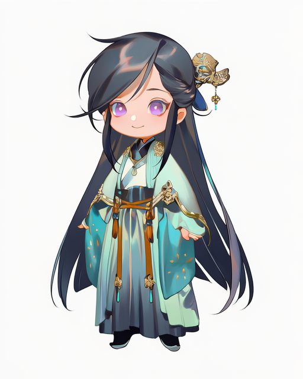
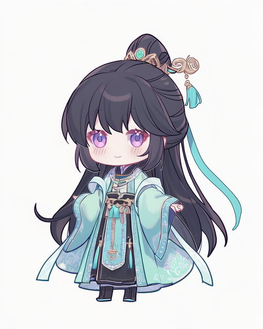
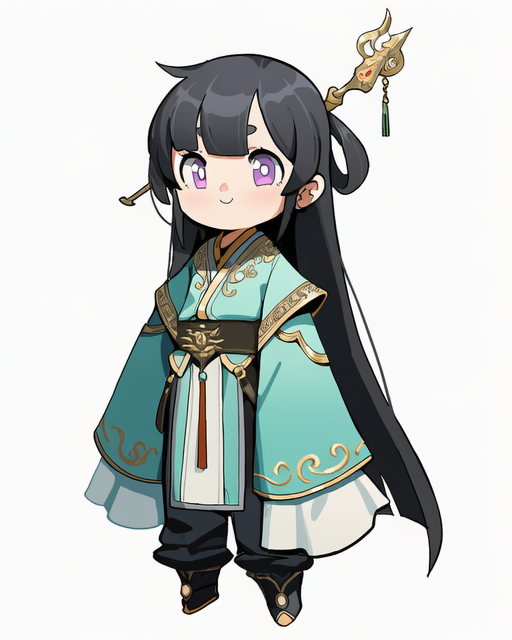
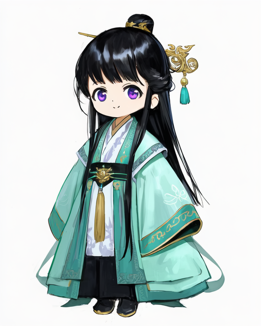
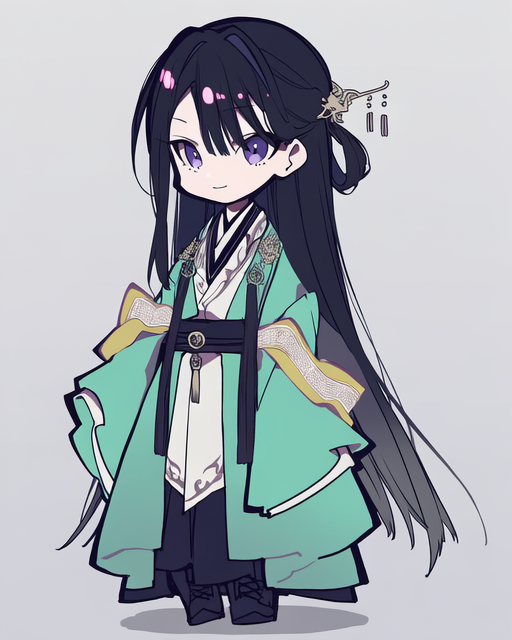
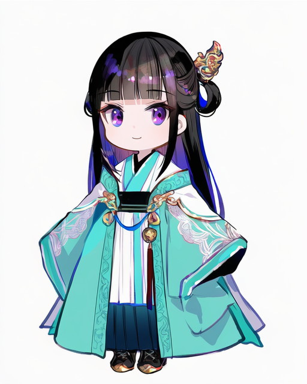

# Q版画师 151-160

[返回目录](../README.md)

## 151 · gomzi

画师标签：`artist:gomzi`

## 152 · henreader

画师标签：`artist:henreader`

## 153 · jima

画师标签：`artist:jima`

构图偏差：出现额外人物或大小人物对照。

## 154 · maccha_(mochancc)

画师标签：`artist:maccha_(mochancc)`

## 155 · rei (sanbonzakura)

画师标签：`artist:rei (sanbonzakura)`

## 156 · umehara_sei

画师标签：`artist:umehara_sei`

## 157 · waterkuma

画师标签：`artist:waterkuma`

## 158 · sho_(sho_lwlw)

画师标签：`artist:sho_(sho_lwlw)`

## 159 · mochizuki kei

画师标签：`artist:mochizuki kei`

## 160 · fuzichoco

画师标签：`artist:fuzichoco`

[下一组](161-170.md)
