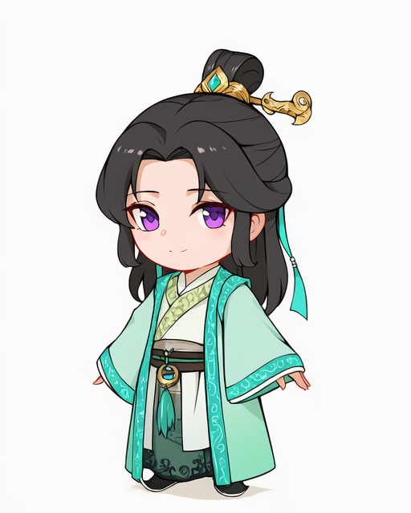
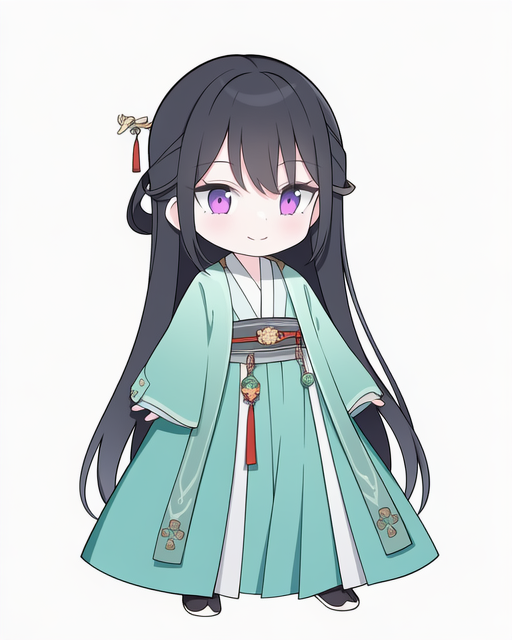
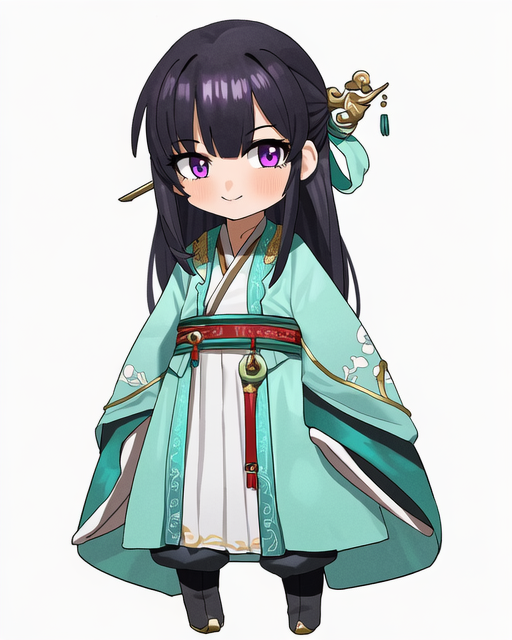
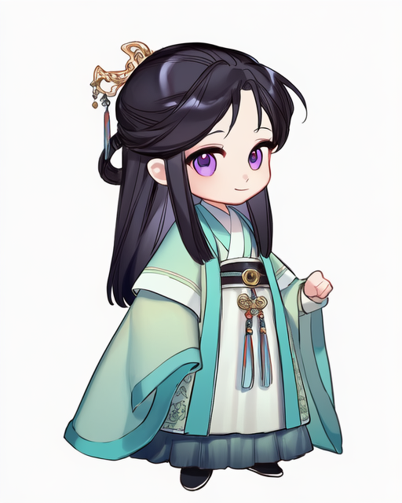
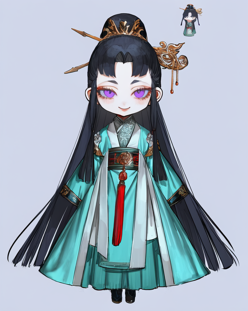
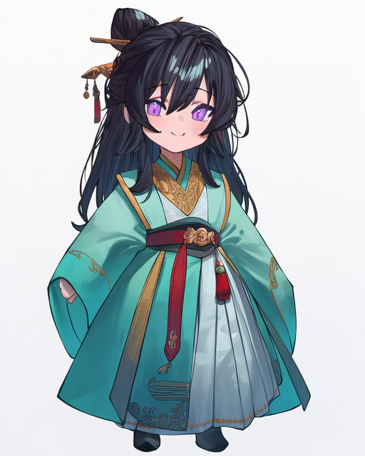
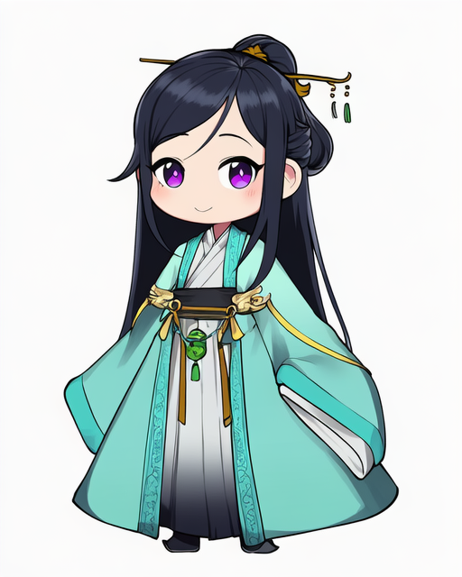
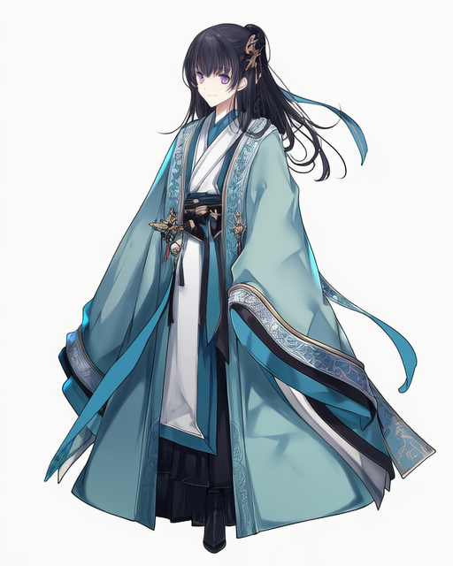
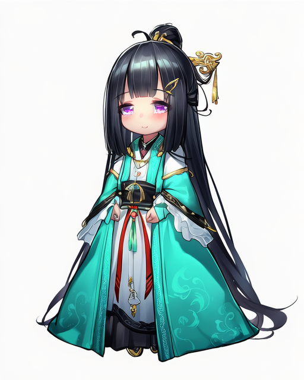

# Q版画师 201-210

[返回目录](../README.md)

## 201 · laserflip

画师标签：`artist:laserflip`

## 202 · jyt

画师标签：`artist:jyt`

## 203 · feipin zhanshi

画师标签：`artist:feipin zhanshi`

## 204 · smilesmile1312

画师标签：`artist:smilesmile1312`

## 205 · 0haribo0

画师标签：`artist:0haribo0`

## 206 · au (d elete)

画师标签：`artist:au (d elete)`

## 207 · betabeet

画师标签：`artist:betabeet`

## 208 · chamchami

画师标签：`artist:chamchami`

## 209 · cierra_(ra-bit)

画师标签：`artist:cierra_(ra-bit)`

比例偏差：人物接近正常比例，Q版程度较弱。

## 210 · dk.senie

画师标签：`artist:dk.senie`

[下一组](211-220.md)
